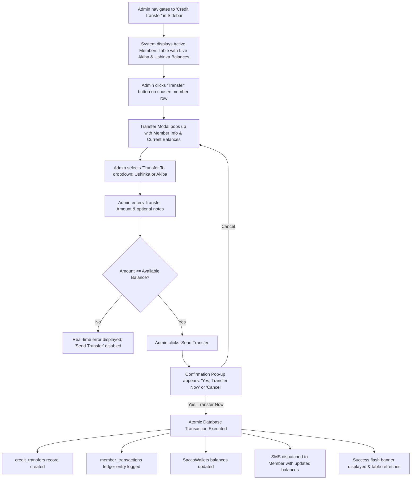
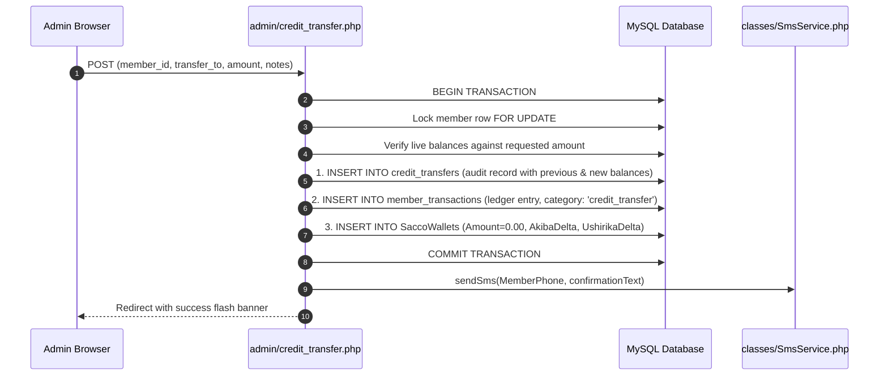

# Credit Transfer System & Process Guide

This guide describes the complete end-to-end process of the **Credit Transfer functionality** in Mashirikiano SACCO. It covers the admin user experience, business logic, database transactions, member notifications, and portal updates.

---

## 1. Process Overview & Objectives

The Credit Transfer feature enables authorized administrators to adjust a member's internal savings distribution between their **Akiba Wallet** (liquid savings) and **Ushirika Shares** (retained cooperative equity).

```
+-------------------------------------------------------------------------------+
|                             MEMBER WALLET POOL                                |
|                                                                               |
|   +--------------------------+                 +--------------------------+   |
|   |       AKIBA WALLET       |                 |     USHIRIKA SHARES      |   |
|   | (95% Everyday Savings)   | <=============> |  (5% Cooperative Equity) |   |
|   | Accessible for withdraw  |  CreditTransfer |  Permanent / Retained    |   |
|   +--------------------------+                 +--------------------------+   |
+-------------------------------------------------------------------------------+
```

### Key Principles:
1. **Zero Net Leakage:** No capital enters or leaves the SACCO during an internal transfer. The member's overall contribution value remains identical.
2. **Direction Flexibility:**
   - **Akiba $\rightarrow$ Ushirika**: Member chooses to convert accessible liquid savings into permanent SACCO shares (e.g. for higher dividend entitlement or loan collateral).
   - **Ushirika $\rightarrow$ Akiba**: Member transfers shares back into liquid savings.
3. **Strict Balance Safeguards:**
   - Transfers cannot exceed the source wallet's current balance.
   - Prevents negative wallet balances.
4. **Full Accountability:** Every transfer records the authorizing admin, exact before/after balances, reference code, and timestamp.
5. **Real-time Member Awareness:** An automated SMS notification is dispatched immediately with the member's new balances.

---

## 2. Admin Step-by-Step Walkthrough



---

### Step 1: Navigating to the Interface
1. Log into the SACCO Admin Portal (`/admin/`).
2. In the left-hand navigation sidebar, click **Credit Transfer** (found directly below *Withdrawals*).
3. The page loads with:
   - **4 Metric Cards**: Active Members count, Total Akiba Pool, Total Ushirika Pool, and Total Transfers completed.
   - **Member Accounts Table**: Searchable and paginated list of all active members.

---

### Step 2: Selecting the Member
In the **Member Wallet Accounts** table, each row shows:
- **Member ID** (e.g. `4113MM1`)
- **Full Name** (e.g. `Micah Mosomi`)
- **National ID** (e.g. `41132513`)
- **Phone Number** (e.g. `0799973820`)
- **Current Akiba** (highlighted in green, e.g. `KES 7,600.00`)
- **Current Ushirika** (highlighted in purple, e.g. `KES 400.00`)
- **Action**: Blue **Transfer** button.

Click the **Transfer** button on the target member's row.

---

### Step 3: Configuring the Transfer in the Pop-up Modal
A pop-up modal opens containing:

1. **Member Summary Card**:
   - Member Name, Member ID, and National ID.
   - Two boxes displaying the member's live **Current Akiba** and **Current Ushirika**.

2. **Transfer To Dropdown**:
   - `Ushirika Shares (Transfer from Akiba Wallet)` *(Default)*
     - Source: **Akiba Wallet**
     - Destination: **Ushirika Shares**
   - `Akiba Wallet (Transfer from Ushirika Shares)`
     - Source: **Ushirika Shares**
     - Destination: **Akiba Wallet**
   - The interface dynamically updates the hint beneath the dropdown indicating available funds in the source wallet.

3. **Transfer Amount (KES)**:
   - Enter the desired amount to move.
   - **Live Validation**: If the amount is $\le 0$ or exceeds the source wallet balance, a red validation warning appears and the *Send Transfer* button is disabled.

4. **Reason / Notes (Optional)**:
   - Input optional context (e.g. *"Top up share capital per member phone request"*).

---

### Step 4: The Confirmation Pop-up
To prevent accidental balance adjustments, clicking **"Send Transfer"** does not immediately save. Instead, it triggers a **Confirmation Modal**:

- Highlights:
  - **Member Name & ID**
  - **Transfer Direction** (e.g. `Akiba Wallet → Ushirika Shares`)
  - **Transfer Amount** (e.g. `KES 1,500.00`)
  - **Authorizing Admin** (e.g. `System Admin`)
- Two options:
  - **Cancel**: Closes the confirmation and returns to the edit form without losing inputs.
  - **Yes, Transfer Now**: Submits the transaction for immediate execution.

---

## 3. Database Execution & Double-Entry Accounting

When confirmed, the server runs an **atomic transaction** across three tables:



### Table 1: `credit_transfers` (Audit Trail)
Stores the dedicated transfer transaction:
```sql
INSERT INTO credit_transfers (
  TransferCode, MemberID, NationalID, TransferFrom, TransferTo,
  Amount, PreviousAkiba, PreviousUshirika, NewAkiba, NewUshirika,
  AdminUserID, AdminName, Notes, CreatedAt
) VALUES (
  'TR-7E81A2BC90', '4113MM1', '41132513', 'akiba', 'ushirika',
  1500.00, 7600.00, 400.00, 6100.00, 1900.00,
  1, 'Admin John', 'Top up share capital', '2026-11-06 20:10:00'
);
```

### Table 2: `member_transactions` (Master Financial Ledger)
Logs an official ledger record so the movement is traceable in audit trails and member transaction statements:
```sql
INSERT INTO member_transactions (
  TranID, MemberID, NationalID, FirstName, LastName, MSISDN,
  Amount, TransactionType, TransactionCategory, Reference, Description, TranTime
) VALUES (
  'TR-7E81A2BC90', '4113MM1', '41132513', 'Micah', 'Mosomi', '0799973820',
  1500.00, 'contribution', 'credit_transfer', 'TR-7E81A2BC90',
  'Credit transfer of KES 1,500.00 from Akiba Wallet to Ushirika Shares', '2026-11-06 20:10:00'
);
```

### Table 3: `SaccoWallets` (Double-Entry Balance Shift)
Records offsetting balance entries. Notice that `Amount = 0.00`, ensuring SACCO gross deposits remain exact:
- **Akiba $\rightarrow$ Ushirika of KES 1,500**:
  ```sql
  INSERT INTO SaccoWallets (TransactionID, TranID, MemberID, NationalID, Amount, AkibaAmount, UshirikaAmount)
  VALUES (last_id, 'TR-7E81A2BC90', '4113MM1', '41132513', 0.00, -1500.00, +1500.00);
  ```
- **Ushirika $\rightarrow$ Akiba of KES 500**:
  ```sql
  INSERT INTO SaccoWallets (TransactionID, TranID, MemberID, NationalID, Amount, AkibaAmount, UshirikaAmount)
  VALUES (last_id, 'TR-8B22C1EF34', '4113MM1', '41132513', 0.00, +500.00, -500.00);
  ```

Because all balance queries in the system calculate:
$$\text{TotalAkiba} = \sum(\text{AkibaAmount})$$
$$\text{TotalUshirika} = \sum(\text{UshirikaAmount})$$
the positive and negative deltas immediately reflect in member balances across all pages without caching issues or desynchronization.

---

## 4. Member SMS Notifications

Upon commit, the system dispatches an automated SMS to the member's registered phone number:

### Credit Transfer SMS:
> *"Dear Micah, a credit transfer of KES 1,500.00 from your Akiba Wallet to Ushirika Shares has been processed successfully (Ref: TR-7E81A2BC90). Current Akiba Wallet: KES 6,100.00, Ushirika Shares: KES 1,900.00. Mashirikiano SACCO."*

### Standard M-Pesa Deposit SMS:
> *"Confirmed. KES 1,000.00 received from Micah Mosomi (ID 41132513) Ref UK77F129 on 06-Nov-2026. Allocation: Akiba (95%) KES 950.00, Ushirika (5%) KES 50.00. Current Akiba Wallet: KES 7,050.00. Ushirika Shares: KES 1,950.00. For queries call 0758500557 or email support@mashirikianosacco.co.ke."*

### Cash Withdrawal SMS:
> *"Dear Micah Mosomi, a withdrawal of KES 500.00 was processed from your Mashirikiano SACCO account on 06-Nov-2026. Current Akiba Wallet: KES 6,550.00.\n\n[SACCO Offer]: Grow your savings! Deposit monthly to qualify for SACCO loans..."*

---

## 5. Member Portal Experience (`/member/dashboard.php`)

When members log into their dashboard:

1. **Top Metric Cards Layout**:
   - **Current Akiba Amount** (Green left accent): Accessible everyday liquid net savings ($\text{Akiba} - \text{Withdrawals}$).
   - **Ushirika Amount** (Purple left accent): Retained cooperative member shares (5% allocations + transfers).
   - **Total Withdrawals** (Red left accent): Total cash released.
   - **Total Contributions**: Cumulative deposits.
   - **Total Loan Balance**: Active approved credit facilities.

2. **Recent Transactions Feed**:
   - Shows normal contributions as `+ KES X.XX` (green).
   - Shows withdrawals as `- KES X.XX` (red).
   - Shows credit transfers as `↔ KES X.XX` (blue) with direction details.

3. **Transactions Statement Tab (`?tab=record`)**:
   - Lists full history with search and date filters.
   - Displays type badge: `Contribution`, `Withdrawal`, or `Credit Transfer`.

---

## 6. Verification & Troubleshooting SQL Queries

Run these queries in phpMyAdmin or the MySQL CLI to verify balances and audit trails:

### Check Audit History for a Member:
```sql
SELECT
  TransferCode, TransferFrom, TransferTo, Amount,
  PreviousAkiba, NewAkiba, PreviousUshirika, NewUshirika,
  AdminName, CreatedAt
FROM credit_transfers
WHERE MemberID = '4113MM1'
ORDER BY CreatedAt DESC;
```

### Verify Member's Live Aggregate Balances:
```sql
SELECT
  m.MemberID,
  CONCAT(m.FirstName, ' ', m.LastName) AS MemberName,
  COALESCE(SUM(w.AkibaAmount), 0) - COALESCE(wd.TotalWithdrawals, 0) AS CurrentAkiba,
  COALESCE(SUM(w.UshirikaAmount), 0) AS CurrentUshirika,
  COALESCE(wd.TotalWithdrawals, 0) AS TotalWithdrawals
FROM members m
LEFT JOIN SaccoWallets w ON w.MemberID = m.MemberID
LEFT JOIN (
  SELECT MemberID, SUM(Amount) AS TotalWithdrawals
  FROM withdrawals
  GROUP BY MemberID
) wd ON wd.MemberID = m.MemberID
WHERE m.MemberID = '4113MM1'
GROUP BY m.MemberID, m.FirstName, m.LastName;
```

---

## 7. Related Files in the Codebase

- **Interface:** [`admin/credit_transfer.php`](file:///c:/Users/nyaka/OneDrive/Desktop/mashirikiano-Website/admin/credit_transfer.php)
- **Sidebar Layout:** [`admin/admin_layout.php`](file:///c:/Users/nyaka/OneDrive/Desktop/mashirikiano-Website/admin/admin_layout.php)
- **Member Dashboard:** [`member/dashboard.php`](file:///c:/Users/nyaka/OneDrive/Desktop/mashirikiano-Website/member/dashboard.php)
- **Database Migration:** [`database/credit_transfer_migration.sql`](file:///c:/Users/nyaka/OneDrive/Desktop/mashirikiano-Website/database/credit_transfer_migration.sql)
- **Unified Schema:** [`database/schema.sql`](file:///c:/Users/nyaka/OneDrive/Desktop/mashirikiano-Website/database/schema.sql)
- **General Architecture Guide:** [`SACCO_WALLETS_AND_WITHDRAWALS_DOCUMENTATION.md`](file:///c:/Users/nyaka/OneDrive/Desktop/mashirikiano-Website/SACCO_WALLETS_AND_WITHDRAWALS_DOCUMENTATION.md)

