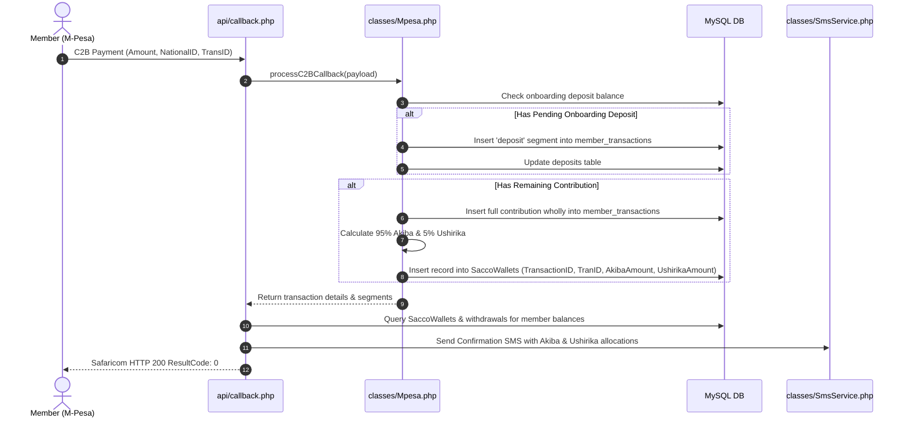
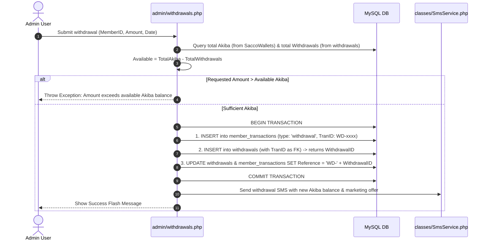

# Sacco Wallets Architecture & Withdrawals Integration Documentation

This document explains the business logic, database architecture, transaction lifecycle, and migration workflow introduced for the **Dual-Wallet System** (Akiba Wallet & Ushirika Shares) and the **Withdrawals-to-Ledger Relationship**.

---

## 1. Overview & Business Objectives

### 1.1 Dual-Wallet System
Historically, member contributions were recorded as a single gross total in `member_transactions`. To introduce capital building while maintaining accessible savings, contributions are now apportioned into two dedicated wallets:

1. **Akiba Wallet (95%)**:
   - Represents the member's regular liquid savings.
   - Calculated as:
     $$\text{Akiba Wallet Balance} = \sum(\text{Akiba Contributions}) - \sum(\text{Cash Withdrawals})$$
   - Cash withdrawals by members are disbursed solely from this wallet.

2. **Ushirika Shares (5%)**:
   - Represents the member's permanent, retained cooperative shares in the SACCO.
   - Non-withdrawable under standard withdrawal operations.
   - Calculated as:
     $$\text{Ushirika Shares} = \sum(\text{Ushirika Contributions})$$

### 1.2 Integer / Cent Balancing Rule
To prevent floating-point discrepancies or cent leakage across transactions:
$$\text{UshirikaAmount} = \text{ROUND}(\text{Amount} \times 0.05, 2)$$
$$\text{AkibaAmount} = \text{ROUND}(\text{Amount} - \text{UshirikaAmount}, 2)$$
This guarantees that:
$$\text{AkibaAmount} + \text{UshirikaAmount} \equiv \text{Amount}$$

---

## 2. Withdrawals and Transactions Linkage

### 2.1 The Problem Solved
Previously, member withdrawals existed across two isolated tables without explicit relational binding:
- `member_transactions`: Contained ledger entries of type `withdrawal` with a unique transaction code (`TranID`, e.g. `WD-7673F3C10A`) and a human-readable `Reference` (e.g. `WD-6`).
- `withdrawals`: Contained withdrawal records with auto-incrementing `WithdrawalID` (e.g. `6`), but had no direct column or Foreign Key referencing the ledger `TranID`.

### 2.2 The Solution
1. **Added Columns to `withdrawals`**:
   - `TranID VARCHAR(60) NULL`: Holds the matching ledger transaction ID.
   - `Reference VARCHAR(120) NULL`: Holds the identifier formatted as `WD-<WithdrawalID>` (e.g. `WD-6`).
2. **Foreign Key Constraint**:
   - `withdrawals.TranID` references `member_transactions.TranID` via constraint `fk_withdrawals_transaction`.
3. **Execution Order in Code**:
   - When a withdrawal occurs, `member_transactions` is inserted first so that `TranID` exists in the parent table.
   - The row in `withdrawals` is then inserted with `TranID`.
   - Both rows are stamped with `Reference = 'WD-' . $withdrawalId` in an atomic database transaction.

---

## 3. Database Schema

### 3.1 `SaccoWallets` Table
```sql
CREATE TABLE IF NOT EXISTS `SaccoWallets` (
  `WalletRecordID` BIGINT UNSIGNED NOT NULL AUTO_INCREMENT,
  `TransactionID` BIGINT UNSIGNED NOT NULL,
  `TranID` VARCHAR(60) NOT NULL,
  `MemberID` VARCHAR(40) NULL,
  `NationalID` VARCHAR(30) NOT NULL,
  `Amount` DECIMAL(12,2) NOT NULL DEFAULT 0.00,
  `AkibaAmount` DECIMAL(12,2) NOT NULL DEFAULT 0.00,
  `UshirikaAmount` DECIMAL(12,2) NOT NULL DEFAULT 0.00,
  `CreatedAt` TIMESTAMP NOT NULL DEFAULT CURRENT_TIMESTAMP,
  `UpdatedAt` TIMESTAMP NOT NULL DEFAULT CURRENT_TIMESTAMP ON UPDATE CURRENT_TIMESTAMP,
  PRIMARY KEY (`WalletRecordID`),
  UNIQUE KEY `uniq_sacco_wallets_transaction` (`TransactionID`),
  KEY `idx_sacco_wallets_tran_id` (`TranID`),
  KEY `idx_sacco_wallets_member` (`MemberID`),
  KEY `idx_sacco_wallets_national_id` (`NationalID`),
  CONSTRAINT `fk_sacco_wallets_transaction`
    FOREIGN KEY (`TransactionID`) REFERENCES `member_transactions` (`TransactionID`)
    ON UPDATE CASCADE
    ON DELETE CASCADE,
  CONSTRAINT `fk_sacco_wallets_member`
    FOREIGN KEY (`MemberID`) REFERENCES `members` (`MemberID`)
    ON UPDATE CASCADE
    ON DELETE SET NULL
) ENGINE=InnoDB DEFAULT CHARSET=utf8mb4 COLLATE=utf8mb4_unicode_ci;
```

### 3.2 `withdrawals` Altered Structure
```sql
ALTER TABLE `withdrawals`
  ADD COLUMN `TranID` VARCHAR(60) NULL AFTER `AdminUserID`,
  ADD COLUMN `Reference` VARCHAR(120) NULL AFTER `TranID`,
  ADD INDEX `idx_withdrawals_tran_id` (`TranID`),
  ADD INDEX `idx_withdrawals_reference` (`Reference`),
  ADD CONSTRAINT `fk_withdrawals_transaction`
    FOREIGN KEY (`TranID`) REFERENCES `member_transactions` (`TranID`)
    ON UPDATE CASCADE
    ON DELETE SET NULL;
```

### 3.3 Aggregation View (`member_wallet_balances`)
```sql
CREATE OR REPLACE VIEW `member_wallet_balances` AS
SELECT
  m.`MemberID`,
  m.`NationalID`,
  m.`FirstName`,
  m.`LastName`,
  COALESCE(w.`TotalContributions`, 0.00) AS `TotalContributions`,
  COALESCE(w.`TotalAkiba`, 0.00) AS `TotalAkiba`,
  COALESCE(w.`TotalUshirika`, 0.00) AS `TotalUshirikaShares`,
  COALESCE(wd.`TotalWithdrawals`, 0.00) AS `TotalWithdrawals`,
  GREATEST(0.00, COALESCE(w.`TotalAkiba`, 0.00) - COALESCE(wd.`TotalWithdrawals`, 0.00)) AS `AkibaWalletBalance`
FROM `members` m
LEFT JOIN (
  SELECT
    `MemberID`,
    SUM(`Amount`) AS `TotalContributions`,
    SUM(`AkibaAmount`) AS `TotalAkiba`,
    SUM(`UshirikaAmount`) AS `TotalUshirika`
  FROM `SaccoWallets`
  WHERE `MemberID` IS NOT NULL
  GROUP BY `MemberID`
) w ON w.`MemberID` = m.`MemberID`
LEFT JOIN (
  SELECT
    `MemberID`,
    SUM(`Amount`) AS `TotalWithdrawals`
  FROM `withdrawals`
  WHERE `MemberID` IS NOT NULL
  GROUP BY `MemberID`
) wd ON wd.`MemberID` = m.`MemberID`;
```

---

## 4. End-to-End Application Workflows

### 4.1 M-Pesa Callback & Contribution Flow


### 4.2 Member Cash Withdrawal Flow


---

## 5. SQL Migration Files in `database/`

The migration is split into self-contained files:

| File Name | Purpose |
| :--- | :--- |
| `database/alter_withdrawals_link_transactions.sql` | Adds `TranID` & `Reference` to `withdrawals`, backfills existing rows (`WD-1` to `WD-8`), and sets the Foreign Key constraint. |
| `database/create_sacco_wallets.sql` | Creates the `SaccoWallets` table with constraints and indexes. |
| `database/seed_sacco_wallets.sql` | Backfills `SaccoWallets` from all existing `contribution` rows in `member_transactions` (95% Akiba / 5% Ushirika). |
| `database/credit_transfer_migration.sql` | Creates the `credit_transfers` table for internal wallet transfer audit logs. |
| `database/member_wallet_balances_view.sql` | Creates the `member_wallet_balances` view for reporting and balances. |
| `database/schema.sql` | Full schema reference updated with all changes. |

### Execution Order:
Run the files in your database tool (e.g. phpMyAdmin, MySQL Workbench, or CLI):
```bash
mysql -u <user> -p mashirikianosacc_mashirikiano < database/alter_withdrawals_link_transactions.sql
mysql -u <user> -p mashirikianosacc_mashirikiano < database/create_sacco_wallets.sql
mysql -u <user> -p mashirikianosacc_mashirikiano < database/seed_sacco_wallets.sql
mysql -u <user> -p mashirikianosacc_mashirikiano < database/credit_transfer_migration.sql
mysql -u <user> -p mashirikianosacc_mashirikiano < database/member_wallet_balances_view.sql
```

---

## 6. Summary of Modified Codebase Files

- **`admin/admin_layout.php`**:
  - Added **Credit Transfer** to the sidebar navigation.
- **`admin/credit_transfer.php`**:
  - Complete admin interface listing users, Current Akiba, and Current Ushirika.
  - Transfer pop-up modal with direction dropdown (`[Akiba, Ushirika]`), amount, and live validation.
  - Secondary confirmation dialog ("Yes, Transfer Now" / "Cancel") before execution.
  - Atomic database transactions updating `credit_transfers`, `member_transactions`, and `SaccoWallets`.
  - Dispatches transfer confirmation SMS to members.
  - Audit log table displaying all completed transfers.
- **`classes/Mpesa.php`**: 
  - Splits contribution payments 95%/5% and inserts into `SaccoWallets`.
  - Added self-healing `ensureSaccoWalletsTable()` method.
- **`classes/MemberService.php`**:
  - Updated `linkUnmatchedContributions()` so when a user registers, both `member_transactions` and `SaccoWallets` are linked to the new `MemberID`.
  - Updated `insertLedgerTransaction()` to support wallet allocation on contributions.
- **`admin/withdrawals.php`**:
  - Calculates maximum withdrawable balance strictly from the **Akiba Wallet** (`TotalAkiba - TotalWithdrawals`).
  - Inserts ledger transaction first, then withdrawals record with `TranID` as FK, and links both with `Reference = WD-<id>`.
  - Displays **Akiba Wallet** and **Ushirika Shares** in member table and summary cards.
  - SMS notification explicitly displays **Current Akiba Wallet**.
- **`admin/withdrawal_logs.php`**:
  - Displays the linked `Reference` (e.g. `WD-6`) and `TranID` for audit tracking.
- **`member/dashboard.php`**:
  - Member UI features **Current Akiba Amount**, **Ushirika Amount**, and **Total Withdrawals** prominently with color-coded borders.
  - Transactions list clearly highlights internal transfers (`↔ KES X.XX`).
- **`admin/index.php`**:
  - Updated metrics grid to show **Akiba Wallet (Net Savings)** and **Ushirika Shares**.
- **`api/callback.php`**:
  - Queries `SaccoWallets` and `withdrawals` to format confirmation SMS explicitly showing **Current Akiba Wallet** and **Ushirika Shares**.

---

## 7. Credit Transfer Business Logic & Mathematical Consistency

### 7.1 Transfer Mechanics
The admin interface allows shifting funds between the member's two wallets:
- **Akiba $\rightarrow$ Ushirika**: Transferred amount cannot exceed member's available `CurrentAkiba`.
- **Ushirika $\rightarrow$ Akiba**: Transferred amount cannot exceed member's available `CurrentUshirika`.

### 7.2 Zero-Leakage Double Entry Shift
When a transfer of amount $X$ occurs:
1. `credit_transfers` records:
   - Previous balances ($Akiba_{prev}, Ushirika_{prev}$)
   - Transferred amount $X$
   - New balances ($Akiba_{new}, Ushirika_{new}$)
   - Authorizing admin ID, name, notes, and timestamp.
2. `member_transactions` records:
   - Ledger entry with unique `TR-XXXXXXXXXX` code.
   - `TransactionCategory = 'credit_transfer'`.
3. `SaccoWallets` records:
   - Gross Amount = $0.00$ (no capital enters or leaves the SACCO).
   - If Akiba $\rightarrow$ Ushirika:
     $$\Delta \text{Akiba} = -X, \quad \Delta \text{Ushirika} = +X$$
   - If Ushirika $\rightarrow$ Akiba:
     $$\Delta \text{Akiba} = +X, \quad \Delta \text{Ushirika} = -X$$

Because all wallet calculations aggregate $\sum(\text{AkibaAmount})$ and $\sum(\text{UshirikaAmount})$ from `SaccoWallets`:
- **Current Akiba** updates instantly across all portals.
- **Current Ushirika** updates instantly across all portals.
- The member receives an SMS notification with their updated balances.

